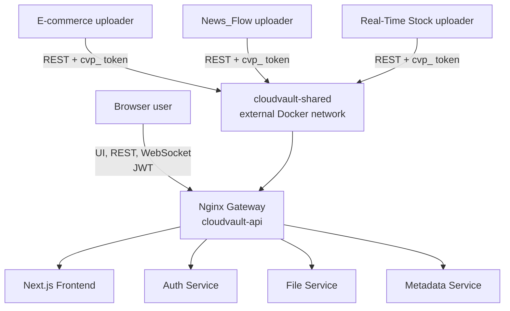
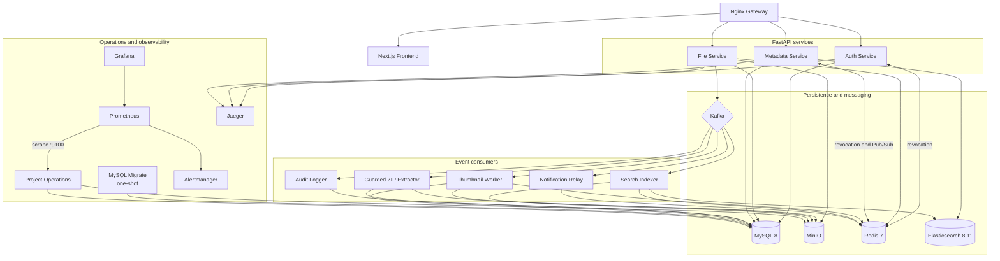
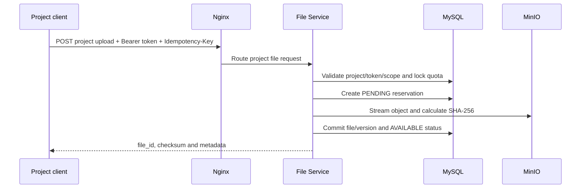
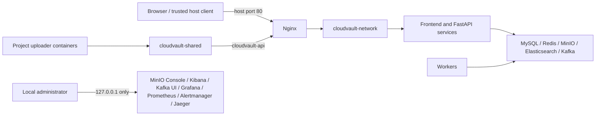

# 🏛️ CloudVault Architecture

CloudVault is a self-hosted storage platform with two isolated ownership models:

- **Personal storage** belongs to one user and powers **My Files**, sharing,
  versions, search and personal trash.
- **Project Storage** belongs to a project boundary and is governed by project
  membership, service-account scopes, project quota and retention policy.

The system uses synchronous REST/WebSocket paths for interactive requests,
Kafka consumer groups for asynchronous file processing, and a separate
operations plane for reconciliation, retention, metrics and recovery.

## 1. System Context

Nginx is the only component attached to both `cloudvault-network` and the
external `cloudvault-shared` network. Project clients use the stable
`cloudvault-api` alias and never receive direct MySQL, Redis or MinIO access.

## 2. Runtime Topology

### Deployment profiles and failure boundaries

The default Compose profile favors local development and runs one Kafka broker,
one standalone MinIO node and one replica per application workload. The
optional `docker-compose.ha.yml` overlay keeps the same routes and trust
boundaries while providing:

- three ZooKeeper nodes and three Kafka brokers, topic replication factor 3,
  `min.insync.replicas=2` and disabled unclean leader election;
- four MinIO nodes/drives using erasure coding and HA-only volumes;
- multiple stateless frontend/API replicas behind the existing Nginx service;
- multiple instances of each Kafka worker within its existing consumer group;
  and
- per-replica database-pool limits so the aggregate remains operator-controlled.

Migration, bucket initialization and Project Operations remain singleton jobs.
MySQL, Redis and Elasticsearch are not made highly available by this overlay,
and Nginx remains a single gateway. The profile therefore removes important
Kafka, object-storage and worker bottlenecks but is not a complete multi-host
production control plane. The mandatory `CLOUDVAULT_HA_MODE_ACK` guard exists
because standalone and distributed MinIO use incompatible storage layouts;
operators must back up and plan object migration before enabling the overlay.

### API ownership

| Component | Primary responsibilities |
|---|---|
| Nginx | Host entry point, UI/API/WebSocket routing, request limits and project route dispatch |
| Auth Service | Users, JWT lifecycle, admin APIs, projects, membership, project policy, project lifecycle and service accounts |
| File Service | Personal/project folders and files, streamed object I/O, versions, idempotency, quota reservation, trash and project operation status |
| Metadata Service | Metadata views, sharing, activity, Elasticsearch queries and authenticated WebSocket delivery |

Project routes are intentionally split. Nginx sends project lifecycle,
membership and service-account requests to Auth Service, while project file,
folder, usage and operation-status requests go to File Service.

## 3. Identity and Authorization

### Browser users

1. Auth Service verifies credentials against MySQL.
2. It issues a short-lived access JWT and a refresh token whose hash is stored in
   MySQL together with the client IP and user agent.
3. Refresh tokens rotate atomically under a row lock. Reuse of an already
   revoked refresh token is treated as replay and revokes all remaining refresh
   sessions for that user.
4. Logout revokes the current refresh token and stores the access-token `jti` in
   Redis for its remaining lifetime. Password changes revoke every refresh
   session and blacklist the current access token.
5. Users can inspect active refresh sessions and revoke one or all of them from
   Account Settings.
6. Auth, File and Metadata services reject non-access JWTs, blacklisted tokens
   and inactive users.
7. Project access additionally requires system-admin status or project
   membership with the required `viewer`, `editor` or `admin` role.

Registration requires passwords of at least 12 characters. Authentication
abuse protection is layered: Nginx limits requests per source address, while
Auth Service applies configurable Redis-backed limits per client/identity pair.
The application limiter fails open if Redis is unavailable so the gateway
remains the outer protection. Login, logout, refresh replay, password and
session-revocation actions are written to the security audit trail.

### Project applications

1. A project administrator creates a service account and selects scopes.
2. CloudVault returns a `cvp_` token once and stores only its SHA-256 hash,
   prefix, scopes, expiry and lifecycle metadata.
3. The client sends `Authorization: Bearer <cvp_token>` to a project route.
4. File Service derives the authoritative project from the token. A token from
   one project cannot be used against another project ID.
5. Required scopes include `files:create`, `files:read`, `files:delete` and
   `project:usage:read`; clients receive only the scopes they need.
6. Tokens can be rotated or revoked independently. Archiving a project revokes
   active service accounts; restored projects require new token rotation.

## 4. Storage Ownership and Quota

### Personal files

- `project_id` is `NULL`; ownership remains tied to `user_id`.
- Physical storage usage includes retained version objects.
- Soft delete changes metadata state. Permanent delete removes the current
  object, retained versions and derived objects before releasing quota.

### Project files

- `project_id` is the security and quota boundary. Folder names never grant
  access.
- The creator can be a user or service account and remains visible in audit
  metadata.
- Project folders organize content but remain inside the same project boundary.
- Stars and project pins are per-user preferences; they do not modify shared
  project ownership.
- Files in project trash continue to consume project quota until permanently
  deleted.

### Project upload transaction

- `Idempotency-Key` is mandatory for project uploads.
- The same key and content returns a stable result; conflicting reuse is
  rejected.
- Quota is reserved under a project row lock before object acceptance and is
  reconciled after success or failure.
- A file becomes `AVAILABLE` only after its object and metadata are committed.
- Interrupted uploads remain detectable as stale reservations instead of
  silently consuming quota forever.

## 5. Request and Event Flows

### Interactive request flow

1. A browser or project client calls Nginx.
2. Nginx serves the Next.js UI or routes `/api/v1` and `/health` requests to the
   owning API service.
3. The target service authenticates the JWT or service token and applies user,
   membership, role, scope and project-state checks.
4. The service performs synchronous MySQL, MinIO, Redis or Elasticsearch work.
5. Metadata Service sends activity notifications over an authenticated
   WebSocket after Redis Pub/Sub delivery.

The browser authenticates notification WebSockets in the first frame after the
handshake. Access tokens are never placed in WebSocket query strings, preventing
them from appearing in gateway/Uvicorn access logs, browser history or copied
URLs.

The frontend API client does not bypass Nginx. It calls same-origin gateway
routes, and Nginx selects the backend service.

### Kafka event flow

1. File Service publishes versioned events with a stable event ID and ordering
   key. Its producer enables idempotence and waits for all in-sync replicas.
   The `user-events` topic is provisioned for compatible event producers, but
   current project lifecycle audit writes do not depend on it.
2. Audit Logger, ZIP Extractor, Thumbnail Worker and Search Indexer use separate
   consumer groups so each can process the same event independently.
3. Notification Relay runs inside Metadata Service with the
   `metadata-notifications` consumer group and publishes user activity to Redis.
4. Metadata Service subscribes to the per-user Redis channel and pushes events
   over WebSocket.

Consumers disable automatic offset commits. A message is committed only after
its side effect succeeds; failures use bounded retry/backoff and then publish
the original context to `dead-letter-events` so the partition can continue.
Audit and ZIP processing persist event IDs to make redelivery idempotent.
Kafka still provides at-least-once delivery: every new consumer must make its
own external side effects idempotent before it is scaled horizontally.

Audit ownership is split deliberately:

- Audit Logger persists supported Kafka events from its `file-events` and
  `user-events` subscriptions.
- Auth Service writes project lifecycle, membership and service-account audit
  entries synchronously with the project operation.

### Guarded ZIP extraction

The ZIP worker spools archives with bounded memory and rejects excessive entry
counts, expanded sizes, compression ratios and encrypted entries. Extracted
records and quota updates commit together; created objects are cleaned up after
failure.

## 6. Project Lifecycle

- **Active:** normal member and service-account access.
- **Suspended:** policy-controlled state that prevents normal project writes.
- **Archived:** read-only project; active service credentials are revoked.
- **Restored:** returns the project to active management, but service credentials
  must be rotated explicitly.
- **Permanent deletion:** allowed only after every project file, including trash,
  has been permanently removed.

Lifecycle, policy, membership, service-account and storage events appear in the
project activity feed.

## 7. Operations Plane

`project-operations` is a periodic worker, not a Kafka consumer. It compares:

- recorded project usage;
- bytes derived from file versions and active reservations;
- objects and bytes present under the project MinIO prefix;
- stale `PENDING` uploads;
- missing and orphan objects;
- available files past their retention deadline.

The worker exports Prometheus metrics on internal port `9100`. Prometheus
evaluates quota, drift, object-integrity, stale-upload and worker-health rules;
Grafana visualizes them and Alertmanager receives firing alerts.

Reconciliation repair and retention deletion are opt-in. The safe rollout is:

1. observe metrics and run retention in dry-run mode;
2. create an independent metadata/object backup;
3. verify checksums and complete a restore drill;
4. enable one repair/deletion behavior at a time;
5. monitor alerts and retain the original project source until recovery is
   proven.

Operational scripts live in `scripts/operations/`:

- `backup.sh` exports MySQL, project object mappings and MinIO buckets;
- `verify-backup.sh` validates manifest checksums and the SQL archive;
- `restore-drill.sh` restores into isolated temporary MySQL/MinIO containers;
- `recover-project.sh` re-uploads one project through the public CloudVault API
  and records old-to-new `file_id` mappings.

## 8. Database Initialization and Migration

The MySQL image runs the baseline schema for a new volume. The one-shot
`mysql-migrate` service waits for MySQL health and applies ordered, idempotent
migrations before API services start. Project migrations add project ownership,
service accounts, audit context, folders, per-user stars/pins, project operation
status, event-delivery deduplication and refresh-session security metadata
without changing existing personal ownership. Migrations `002` through `011`
are applied in order.

Database and object storage must be backed up together. Restoring only MySQL or
only MinIO can leave valid metadata without objects, or objects without a
reachable `file_id`.

## 9. Network and Security Boundaries

- Nginx is publicly bound by default; direct application and administration
  ports bind to loopback.
- Nginx applies endpoint-specific limits to login, registration, token refresh
  and public-share access, returns JSON `429` responses, propagates a request ID
  and adds baseline CSP, framing, MIME-sniffing, referrer and permissions
  headers. TLS deployments should add HSTS only after HTTPS is enforced.
- Persistence, cache, search and messaging services do not publish host ports,
  except MinIO's loopback-only administration endpoints.
- `cloudvault-shared` contains Nginx and explicitly selected uploader services,
  not CloudVault data services.
- Elasticsearch rejects anonymous access and uses separate bootstrap, Kibana
  and least-privilege application users.
- Redis, MinIO and Grafana require configured credentials. Compose rejects
  missing required secrets.
- Direct-development CORS is an explicit `CORS_ALLOWED_ORIGINS` list; normal UI
  traffic stays same-origin through Nginx.
- Frontend, API and worker containers run as non-root users with all Linux
  capabilities dropped and `no-new-privileges` enabled. API and periodic-worker
  source mounts are read-only; production code changes require an image rebuild.
- TLS should terminate at Nginx or a trusted upstream proxy in production.

## 10. Health and Observability Semantics

Nginx exposes live checks for the three API services:

- `/health/auth`
- `/health/file`
- `/health/metadata`

The Project Operations container has an internal health check against its
Prometheus metrics endpoint. Other components are represented as documented
topology unless an aggregate health API is added. The Architecture tab therefore
distinguishes live API nodes from documented nodes instead of implying that
every displayed component is actively probed.

This document is the canonical architecture description. The README diagram is
a compact system-context view; the in-app Architecture tab is its interactive
topology view.
