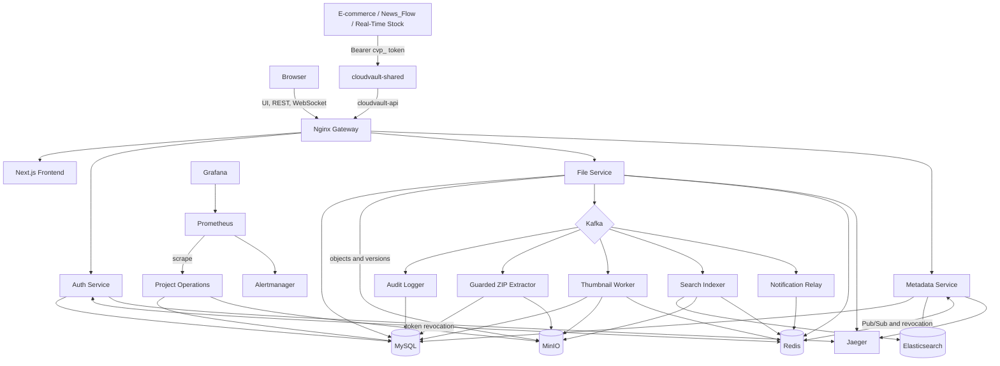

# ☁️ CloudVault — Self-Hosted Personal & Project Storage

[](https://www.python.org/)
[](https://fastapi.tiangolo.com/)
[](https://nextjs.org/)
[](https://www.docker.com/)
[](https://opensource.org/licenses/MIT)

CloudVault is a self-hosted storage platform for personal files and isolated
project artifacts. It combines a Next.js interface, FastAPI microservices,
MinIO object storage, event-driven workers, project-scoped machine credentials,
and an operations plane for quota and object-integrity monitoring.

> **Current status:** Personal storage and Project Storage phases 0–8 are
> implemented in the Docker Compose stack. Automatic retention/deletion remains
> opt-in and should be enabled gradually after backup and restore validation.

---

## ✨ Key Features

### Personal storage

- Streamed S3-compatible uploads to MinIO with file-version retention.
- Personal folders, starred files, trash, sharing links and storage quota.
- JWT access/refresh tokens, atomic refresh rotation, replay detection and
  Redis-backed revocation.
- Account Settings for profile/avatar, TOTP MFA with one-time recovery codes,
  recent security activity, per-device session revocation, browser preferences
  and privacy exports. Account deletion uses impact checks, project ownership
  transfer, a seven-day cancellation window and asynchronous object cleanup.
- Full-text search through authenticated Elasticsearch.
- In-app preview for images, video, audio, PDF, text, JSON, XML and CSV.
- Kafka workers for thumbnails, indexing, guarded ZIP extraction, audit events
  and real-time Redis/WebSocket notifications.

### Project Storage

- Projects are isolated authorization and quota boundaries, separate from
  **My Files**.
- Project members use `viewer`, `editor` and `admin` roles.
- Applications authenticate with one-time-issued `cvp_` service tokens and
  least-privilege scopes such as `files:create` and `files:read`.
- Project uploads use stable idempotency keys, SHA-256 checksums and atomic quota
  reservation.
- Project folders, filters, per-user stars, bulk actions, preview, trash,
  archive/restore and audited lifecycle controls are available in the UI.
- E-commerce, News_Flow and Real-Time Stock clients connect through the shared
  gateway network without receiving direct MySQL or MinIO credentials.

### Operations and observability

- `project-operations` reconciles recorded usage, metadata and MinIO objects;
  detects stale uploads, missing/orphan objects and expired files.
- Prometheus metrics, Grafana dashboard and Alertmanager rules cover project
  quota, integrity, operation health and failed account-data purges.
- OpenTelemetry traces from the API services are exported to Jaeger.
- Backup, verification, restore-drill and selective project-recovery scripts are
  provided under `scripts/operations/`.
- An optional HA overlay provides three Kafka brokers, four distributed MinIO
  nodes and horizontally scaled API/worker replicas without changing the
  lightweight development profile.

---

## 🏗️ Architecture

CloudVault exposes one gateway to browsers and project clients. Internal data
services remain on `cloudvault-network`; only Nginx also joins the external
`cloudvault-shared` network under the alias `cloudvault-api`.



Project lifecycle actions handled by Auth Service are written synchronously to
the project audit trail. File events are published through Kafka and persisted
by Audit Logger. Notification Relay uses its own
`metadata-notifications` consumer group so notification delivery does not
compete with audit processing.

See [ARCHITECTURE.md](ARCHITECTURE.md) for trust boundaries, request flows,
project authorization, storage semantics and operational recovery.

---

## 🛠️ Tech Stack

| Domain | Technology | Purpose |
|---|---|---|
| Frontend | Next.js 16.4.1, React 19, TypeScript | UI, previews and interactive topology |
| Backend | Python 3.11, FastAPI 0.115.6, SQLAlchemy | Async API microservices |
| Database | MySQL 8.0, asyncmy | Users, projects, metadata, versions and audit |
| Cache and Pub/Sub | Redis 7 | JWT revocation and WebSocket notifications |
| Object storage | MinIO | Personal and project objects/version storage |
| Event bus | Apache Kafka, ZooKeeper | `file-events` and `user-events` |
| Search | Elasticsearch 8.11, Kibana | Full-text indexing and administration |
| Observability | Prometheus, Grafana, Alertmanager, Jaeger | Metrics, alerts, dashboards and traces |
| Routing | Nginx | Gateway, API routing and WebSocket proxy |

---

## 🚀 Quick Start

### Prerequisites

- Docker Engine and Docker Compose v2+
- Node.js `>=20.9.0` for local frontend development
- Python 3.11+ for validation and operations scripts

### Start the complete stack

```bash
git clone https://github.com/hquan07/CloudVault.git
cd CloudVault

cp .env.example .env
# Fill every required password/secret. Generate independent values with:
# openssl rand -hex 32

# Compose declares this as an external network, so create it once first.
./scripts/setup_shared_network.sh

docker compose config -q
docker compose up -d --build
docker compose ps
```

Access the application through Nginx at [http://localhost](http://localhost).
The direct frontend port `3000` is bound to loopback for local debugging.

### High-availability profile

The default `docker-compose.yml` remains the development profile: one Kafka
broker, one standalone MinIO node and one instance of each application service.
For capacity and single-node failure testing, `docker-compose.ha.yml` adds:

- a three-node ZooKeeper ensemble and three Kafka brokers with replication
  factor 3, `min.insync.replicas=2` and unclean leader election disabled;
- four distributed MinIO nodes on dedicated volumes;
- configurable replicas for the frontend, APIs and Kafka workers; and
- bounded Kafka retries, manual offset commits, idempotent side effects and a
  dead-letter topic for poison events.

Distributed MinIO cannot reuse the standalone `minio-data` volume. Back up and
verify the existing MySQL/MinIO data, plan a controlled object migration, then
explicitly acknowledge the mode change:

```bash
export CLOUDVAULT_HA_MODE_ACK=backup-and-migration-reviewed
docker compose -f docker-compose.yml -f docker-compose.ha.yml config -q
docker compose -f docker-compose.yml -f docker-compose.ha.yml up -d --build
./scripts/operations/validate-ha.sh
```

Do not switch between standalone and distributed MinIO against the same data
volume. The overlay improves process and disk failure tolerance on one Docker
host; multi-host production resilience still requires an orchestrator,
independent hosts and external backup/restore procedures.

### Run the frontend locally

```bash
cd frontend
npm ci
npm run dev
```

---

## 🔌 Service Port Registry

Only Nginx is publicly bound by default. Application and administration ports
bind to loopback; persistence and messaging services stay Docker-internal.

| Service / Container | Host Port | Exposure | Description |
|---|---:|---|---|
| Nginx Gateway | `80` | Public (`NGINX_BIND_ADDRESS`) | UI, API and WebSocket entry point |
| Next.js Frontend | `3000` | Loopback (`APP_BIND_ADDRESS`) | Direct frontend debugging |
| Auth Service | `8001` | Loopback (`APP_BIND_ADDRESS`) | Users, projects, members and service accounts |
| File Service | `8002` | Loopback (`APP_BIND_ADDRESS`) | Personal/project file and folder operations |
| Metadata Service | `8003` | Loopback (`APP_BIND_ADDRESS`) | Sharing, search, activity and WebSocket API |
| MinIO API / Console | `9000` / `9001` | Loopback (`INFRA_BIND_ADDRESS`) | Object storage and administration |
| Kibana | `5601` | Loopback (`INFRA_BIND_ADDRESS`) | Search administration |
| Kafka UI | `8080` | Loopback (`INFRA_BIND_ADDRESS`) | Kafka administration |
| Grafana | `3001` | Loopback (`INFRA_BIND_ADDRESS`) | Metrics dashboards |
| Prometheus | `9090` | Loopback (`INFRA_BIND_ADDRESS`) | Time-series metrics |
| Alertmanager | `9093` | Loopback (`INFRA_BIND_ADDRESS`) | Quota, integrity and operation alerts |
| Jaeger | `16686` | Loopback (`INFRA_BIND_ADDRESS`) | Distributed tracing UI |
| Project Operations | None (`9100` internal) | Docker network only | Reconciliation/retention metrics and health |
| Account Deletion Worker | None (`9101` internal) | Docker network only | Delayed personal-data purge metrics and health |
| MySQL / Redis / Elasticsearch / Kafka / ZooKeeper | None | Docker network only | Internal data, cache, search and messaging |

## 🔐 Security Boundaries

- Required secrets have no committed defaults. Keep `.env` local and use a
  different random value for every password and `JWT_SECRET_KEY`.
- Browser users authenticate with JWTs. Project applications use independently
  revocable, scope-limited service tokens; CloudVault stores token hashes only.
- Login, registration, refresh and public-share access have gateway limits;
  authentication also applies an identity-aware Redis limit and records
  security audit events.
- Refresh tokens rotate atomically. Replaying a revoked refresh token revokes
  the user's remaining refresh sessions, and password changes sign out every
  refresh session.
- MySQL, Redis, Elasticsearch, Kafka and ZooKeeper are only reachable through
  `cloudvault-network`.
- `cloudvault-shared` exposes only the Nginx gateway to connected project
  uploader services. It does not expose MySQL, Redis or MinIO.
- Elasticsearch uses separate bootstrap, Kibana and least-privilege application
  accounts. Redis, Grafana and MinIO require configured credentials.
- Nginx adds baseline browser security headers and a request ID. FastAPI CORS
  uses the `CORS_ALLOWED_ORIGINS` allowlist instead of a wildcard.
- Notification WebSockets authenticate in their first frame so access tokens do
  not appear in request URLs or access logs.
- Account deletion is never a direct user-row delete: ownership blockers are
  resolved first, sessions are revoked immediately, and a dedicated worker
  purges personal objects before anonymizing identity data.
- Application containers run without Linux capabilities, cannot gain new
  privileges, use non-root users, and mount development source read-only.
- Keep `APP_BIND_ADDRESS` and `INFRA_BIND_ADDRESS` on `127.0.0.1` unless a
  firewall/private network protects access. Terminate TLS at Nginx or an
  upstream trusted proxy in production.

## ♻️ Project Operations and Recovery

`project-operations` is observe-only by default. Reconciliation fixes and
retention deletion require explicit operator configuration. Before enabling
destructive retention, create and verify a metadata/object backup and complete a
restore drill.

Command forms:

```bash
./scripts/operations/backup.sh /absolute/path/outside-docker-volumes
./scripts/operations/verify-backup.sh /absolute/path/to/cloudvault-backup
./scripts/operations/restore-drill.sh /absolute/path/to/cloudvault-backup
./scripts/operations/recover-project.sh BACKUP_DIR SOURCE_SLUG TARGET_PROJECT BASE_URL SERVICE_TOKEN --dry-run
```

---

## 🧪 Validation

The repository currently uses static/build validation and operational smoke
checks; it does not contain the previously referenced `scripts/test_phase4.py`
test suite.

```bash
docker compose config -q
python3 -m compileall -q services workers
bash -n infrastructure/mysql/run-migrations.sh scripts/setup_shared_network.sh scripts/operations/*.sh

cd frontend
npm ci
npm run lint
npm run build
```

After startup:

```bash
curl -fsS http://localhost/health/auth
curl -fsS http://localhost/health/file
curl -fsS http://localhost/health/metadata
docker compose ps
```

To exercise concurrent project uploads with unique idempotency keys, required
metadata and checksums, use a temporary project or remove the generated test
files afterwards:

```bash
export CLOUDVAULT_PROJECT_TOKEN='cvp_...'
python3 scripts/load/concurrent_project_upload.py \
  --project PROJECT_SLUG --requests 20 --workers 8
```

Add `--allow-quota-rejections` only when intentionally testing a near-full
project and treating HTTP 413 as an expected hard-quota response.

---

## 📝 License

Distributed under the MIT License. See [LICENSE](LICENSE).
