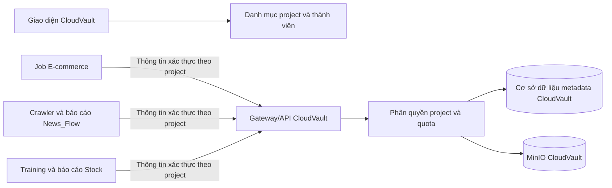

# Tích hợp Projects với CloudVault — Lộ trình triển khai

**Trạng thái:** Kế hoạch triển khai; các chức năng được đề xuất trong tài liệu này chưa được mặc định là đã có.  
**Phạm vi:** CloudVault cùng `ecommerce-data-platform`, `News_Flow` và `Real-Time_Stock_Prediction_Pipeline`.  
**Nguyên tắc dung lượng:** CloudVault còn hạn chế dung lượng. Chỉ lưu các sản phẩm đầu ra đã chọn lọc, có giá trị sử dụng; không chuyển toàn bộ dữ liệu làm việc của từng dự án.

## 1. Hiện trạng

CloudVault hiện có tài khoản người dùng, quota và dung lượng đã dùng theo người dùng, folder, file, lưu trữ qua MinIO, quản lý phiên bản và giao diện web. File API hiện xác thực bằng JWT người dùng. Schema hiện gắn file và folder với `user_id`; chưa có quyền sở hữu theo project, thành viên project, service account cho ứng dụng hoặc quota riêng cho project. Giao diện hiện tập trung vào file và folder cá nhân.

Vì vậy, thiết kế tích hợp cần bổ sung project thành một ranh giới quyền hạn và quota thực sự, không chỉ là folder mang tên ứng dụng. Nội dung cá nhân và các endpoint hiện hữu cần tiếp tục hoạt động.

Ba dự án hiện có kiểu lưu trữ khác nhau:

| Dự án | Cách lưu hiện tại | Phạm vi CloudVault ban đầu |
|---|---|---|
| E-commerce | MinIO riêng cho dữ liệu Olist thô/Bronze; Spark đọc đường dẫn S3A; Airflow có các bước batch | Báo cáo đã chọn, kết quả kiểm tra chất lượng dữ liệu và model artifact được duyệt; giữ nguyên data lake hiện tại |
| News_Flow | MinIO riêng cho bucket `raw-html` qua Scrapy; MongoDB/ClickHouse cho nội dung và báo cáo; có backup cục bộ | Báo cáo intelligence được chọn và HTML được chọn rõ ràng với thời hạn ngắn; không tải cả thư mục backup |
| Real-Time Stock | PostgreSQL cho dữ liệu thị trường/dự đoán; model artifact có phiên bản và MLflow lưu riêng | Các phiên bản model đã kiểm định cùng báo cáo tín hiệu/dự đoán; ban đầu giữ dữ liệu vận hành và file inference tại chỗ |

## 2. Kiến trúc đích

Tab **Projects** chỉ liệt kê project mà người dùng có quyền xem. Trang chi tiết hiển thị file, dung lượng đã dùng/quota, chính sách và quản trị service account cho người có quyền quản trị. **My Files** tiếp tục là vùng cá nhân. File thuộc project có thể được sắp xếp bằng folder, nhưng folder không phải ranh giới bảo mật.

Với Docker Compose local, giữ mạng riêng `cloudvault-network` hiện có của CloudVault. Chỉ nối gateway CloudVault (Nginx) vào mạng ngoài mới `cloudvault-shared`. Chỉ nối các service client thực sự upload/download vào mạng ngoài này. Không nối client vào mạng riêng của CloudVault và không publish cổng MinIO/cơ sở dữ liệu để phục vụ tích hợp. Dùng alias ổn định cho gateway, ví dụ `cloudvault-api`; container gọi URL nội bộ như `http://cloudvault-api` cùng cổng gateway đang lắng nghe. Trình duyệt và presigned URL cần URL truy cập được từ host; không dùng hostname chỉ có hiệu lực bên trong Docker.

## 3. Các giai đoạn triển khai

### Giai đoạn 0 — Hợp đồng tích hợp và chính sách dung lượng ✅

**Công việc**

- Xác nhận CloudVault đang chạy local hay chưa; ghi nhận URL gateway có thể truy cập, dung lượng object còn trống, kích thước file tối đa và nơi lưu bản backup.
- Chốt ID project: `ecommerce`, `news-flow`, `real-time-stock`.
- Thống nhất nhóm file ban đầu, kích thước tối đa, thời hạn lưu và quota cho từng project. Dùng cấu hình có thể thay đổi và chừa dung lượng cho file cá nhân, phiên bản cũ, thumbnail và hoạt động hệ thống.
- Định nghĩa cách upload ổn định: metadata, idempotency, trạng thái file và cách tính quota (bao gồm các phiên bản vật lý còn lưu nếu chính sách giữ chúng).
- Giữ API version dưới `/api/v1`; thông tin xác thực của ứng dụng phải tách biệt JWT đăng nhập của người dùng.

**Điều kiện hoàn tất**

- Có hợp đồng tích hợp được rà soát và chọn một loại file nhỏ làm pilot đầu tiên.
- Không project nào mặc định upload toàn bộ data lake, cây backup, cache, log hoặc workspace training.

Hợp đồng MVP đã chốt tại [PHASE_0_CONTRACT.md](PHASE_0_CONTRACT.md).

### Giai đoạn 1 — Mô hình project và migration cơ sở dữ liệu CloudVault

**Công việc**

- Thêm bản ghi project, thành viên/vai trò project, service account và chính sách/quota project.
- Thêm `project_id` có thể để trống vào file và folder (hoặc quan hệ sở hữu tương đương), đồng thời giữ nguyên ngữ nghĩa `user_id` cho nội dung cá nhân. Xác định quan hệ giữa file project, người tạo và người quản trị.
- Lưu hash của service token cùng scope, trạng thái, thời điểm tạo/hết hạn/rotate/revoke. Không lưu hoặc ghi log token gốc.
- Tạo migration/backfill để các dòng hiện có vẫn là dữ liệu cá nhân (`project_id = NULL`). Sao lưu và xác minh database trước migration; migration phải chạy lại an toàn.
- Thêm unique constraint và index cho project ID, service account ID, truy vấn file theo project và idempotency key.

**Điều kiện hoàn tất**

- Các thao tác file cá nhân vẫn đi theo cơ chế sở hữu hiện tại.
- Có thể tạo project và kiểm tra membership; tên folder không thể làm phát sinh quyền truy cập project.

### Giai đoạn 2 — Xác thực máy, File API và tính quota chính xác

**Công việc**

- Thêm xác thực máy theo project và scope như `files:create`, `files:read`, tùy chọn `files:delete`. Lấy danh tính project từ credential đã xác thực; từ chối hoặc bỏ qua project ID client tự gửi nếu không khớp.
- Tái sử dụng luồng file hiện có khi phù hợp; bổ sung quyền sở hữu project cho upload, liệt kê, metadata, download, version và delete.
- Hỗ trợ idempotency key để Airflow retry không tạo bản trùng ngoài ý muốn. Định nghĩa hành vi khi cùng key/cùng nội dung và cùng key/khác nội dung.
- Giữ chỗ quota một cách nguyên tử trước khi nhận dữ liệu; hoàn lại/cân chỉnh reservation nếu upload thất bại. Chỉ đánh dấu file `AVAILABLE` sau khi xác minh cả object lẫn metadata; có quy trình dọn object mồ côi và upload treo.
- Tính usage theo nguồn dữ liệu nhất quán. Tính các phiên bản object được giữ lại theo chính sách đã chốt ở Giai đoạn 0. Ngăn upload đồng thời vượt hard quota mà không được phát hiện.
- Giới hạn kích thước/loại file, xác minh checksum, giới hạn tốc độ, timeout và audit event. Không cấp credential MinIO cho client.
- Bổ sung endpoint usage project và lỗi quota dễ hiểu.

**Điều kiện hoàn tất**

- Project A không thể liệt kê, tải, ghi đè hoặc xóa file Project B, kể cả khi đoán được file ID.
- Upload đồng thời không âm thầm vượt quota; upload bị ngắt không chiếm quota vĩnh viễn.
- Upload/download chỉ dùng CloudVault API và trả về `file_id` ổn định.

### Giai đoạn 3 — Giao diện Projects

**Công việc**

- Thêm tab **Projects** cạnh **My Files**.
- Thêm trang danh sách và trang chi tiết project. Hiển thị vai trò thành viên, usage/quota, retention/chính sách và file project.
- Chỉ cho phép người có quyền tạo project và quản lý service account. Chỉ hiển thị secret khi cấp mới; hỗ trợ rotate/revoke, không thể xem lại secret cũ.
- Giữ luồng file cá nhân, chia sẻ, thùng rác và version tách biệt với file project.
- Hiển thị trạng thái rõ ràng khi project trống, gần hết quota, upload lỗi hoặc bị từ chối quyền.

**Điều kiện hoàn tất**

- Người dùng phân biệt được dữ liệu cá nhân với dữ liệu project và xem đúng usage.
- Việc chọn project trên giao diện không thay thế phân quyền backend.

### Giai đoạn 4 — Kết nối Compose local và hợp đồng client

**Công việc**

- Tạo `cloudvault-shared` như mạng Docker ngoài theo hướng dẫn local; cho gateway CloudVault nối vào mạng này cùng mạng riêng hiện tại.
- Chỉ thêm khai báo mạng ngoài vào đúng service cần upload/download của mỗi project, không thêm vào database, broker, UI hoặc worker không liên quan.
- Cấu hình alias gateway ổn định, `CLOUDVAULT_BASE_URL`, credential project, timeout kết nối/đọc, retry và giới hạn file trong cơ chế secret/config của từng project.
- Dùng API qua gateway CloudVault từ container. Chưa dùng presigned upload ở MVP trừ khi URL của API/gateway/MinIO truy cập được từ đúng nơi thực hiện upload.
- Thêm một client wrapper nhỏ trong mỗi repo để thống nhất endpoint, xác thực, idempotency, checksum và xử lý lỗi.

**Điều kiện hoàn tất**

- Container client phân giải DNS và truy cập gateway.
- Database và MinIO của CloudVault không thể được client truy cập trực tiếp; chỉ gọi được API CloudVault.

### Giai đoạn 5 — Pilot: báo cáo E-commerce

**Công việc**

- Bắt đầu bằng một báo cáo nhỏ được sinh ra ở bước pipeline thật. DAG hiện tại có các bước ingestion mô phỏng, vì vậy cần xác định output thật trước khi nối upload.
- Upload báo cáo cuối cùng và tùy chọn kết quả kiểm tra chất lượng gọn sau khi tạo thành công; lưu `file_id` trả về với report run hoặc bản ghi project phù hợp.
- Giữ Olist raw, Bronze/Silver, dữ liệu tạm Spark, Kafka và PostgreSQL trong stack hiện tại.
- Kiểm tra retry, chống trùng, xử lý hết quota và download có phân quyền.

**Điều kiện hoàn tất**

- Một báo cáo xuất hiện trong Projects → E-commerce, tải được qua CloudVault và được liên kết bằng `file_id` từ client.
- Chạy lại cùng logical date không tạo bản trùng ngoài ý muốn.

### Giai đoạn 6 — Tích hợp News_Flow

**Công việc**

- Trước tiên thêm upload cho export intelligence/briefing theo lịch. Nội dung report vẫn giữ phạm vi owner trong News_Flow; không tự động cho tất cả thành viên project xem nếu chính sách sản phẩm chưa cho phép.
- Chỉ lưu raw HTML theo lựa chọn. Thêm bộ lọc, checksum URL/nội dung, idempotency ổn định, giới hạn kích thước, retention ngắn và công tắc tắt cấu hình được.
- Nếu upload bắt buộc thất bại, hiển thị task lỗi hoặc trạng thái có thể retry; không âm thầm coi như đã lưu. Luồng Mongo/Kafka hiện tại vẫn hoạt động riêng.
- Không upload thư mục `backups` hiện có hoặc toàn bộ crawler output.

**Điều kiện hoàn tất**

- Export theo lịch chỉ được upload một lần mỗi logical run và giữ đúng quyền owner/project của News_Flow.
- HTML được chọn tuân theo retention/quota; có thể tắt upload CloudVault mà không làm hỏng crawler thông thường.

### Giai đoạn 7 — Tích hợp Real-Time Stock

**Công việc**

- Chỉ upload model đã train, có phiên bản và qua kiểm định cùng metadata. Ghi model type, phạm vi ticker, schema feature, phiên bản thư viện/runtime, checksum và thời điểm training.
- Ban đầu dùng CloudVault làm bản sao/catalog bền vững; pipeline vẫn dùng artifact local/MLflow cho inference. Chỉ chuyển inference sang tải từ xa sau khi xác định availability, tương thích và rollback.
- Upload export tín hiệu/dự đoán gọn nếu cần; giữ lịch sử thị trường, PostgreSQL, Airflow log, checkpoint, file tạm training và model chưa kiểm định ở local.
- Dùng idempotency key theo version bất biến; không âm thầm ghi đè version model đã có.

**Điều kiện hoàn tất**

- Model version đã kiểm định và metadata tải lại được bằng `file_id`; vẫn còn version chạy tốt trước đó để rollback.
- CloudVault gián đoạn không khiến pipeline nạp model chưa hoàn chỉnh hoặc chưa được xác minh.

### Giai đoạn 8 — Vận hành, khôi phục và mở rộng dần

**Công việc**

- Theo dõi thành công/lỗi/độ trễ API, usage/quota theo project, dung lượng object, upload `PENDING` quá lâu, sai lệch reconciliation và lưu lượng từng project.
- Đặt ngưỡng cảnh báo/critical và báo chủ project trước khi chạm hard quota.
- Định nghĩa retention và xóa; xác minh việc xóa mọi version/derived object và hoàn quota.
- Sao lưu cả metadata CloudVault lẫn object storage ra nơi độc lập. Diễn tập restore và kiểm tra checksum cùng ánh xạ `file_id`.
- Triển khai lần lượt theo project và loại file. Giữ nguồn MinIO/local hiện có đến khi bản sao CloudVault được xác minh và phục hồi được; sau đó mới quyết định có dọn object cũ không.
- Viết hướng dẫn khởi động Compose local, tạo network, rotate credential, xử lý gián đoạn, hết quota và khôi phục.

**Điều kiện hoàn tất**

- Diễn tập restore thành công; usage đối chiếu được với object; vận hành viên có thể revoke credential và khôi phục một project mà không ảnh hưởng project khác.

## 4. Chính sách ban đầu đề xuất

Đây là gợi ý khởi đầu, không phải phép đo dung lượng. Chỉ đặt quota số cụ thể sau khi đo dung lượng CloudVault còn trống và chừa dự phòng cho nội dung cá nhân, version cũ, thumbnail và tăng trưởng.

| Project | Ưu tiên ban đầu | Retention gợi ý | Nội dung ban đầu |
|---|---|---|---|
| `ecommerce` | Trung bình/cao | Báo cáo 90–365 ngày; kết quả kiểm tra 30–90 ngày | Báo cáo cuối nhỏ và artifact được duyệt |
| `news-flow` | Trung bình | Export intelligence 30–90 ngày; HTML chọn lọc 7–30 ngày | Ưu tiên report; raw HTML phải bật chọn lọc |
| `real-time-stock` | Trung bình | Giữ model version đến khi được retire rõ ràng; report 30–90 ngày | Model bundle đã kiểm định và output gọn |

Model bundle nên được xem là version cần bảo vệ, không phải file tạm. Đặt giới hạn từng file và hard quota từng project. Không phân bổ hết dung lượng MinIO hiện có; cần để lại khoảng dự phòng.

## 5. Quy tắc phát hành và rollback

- Dùng migration bổ sung, có đường backup/restore đã kiểm chứng; không xóa các trường sở hữu cá nhân trong đợt đầu.
- Bật tích hợp theo từng service và loại file bằng cấu hình.
- Giữ data lake MinIO, quy trình backup News_Flow và artifact local/MLflow của Stock cho đến khi bản CloudVault được xác minh.
- Upload lỗi không được xóa file nguồn hoặc đánh dấu artifact là đã lưu an toàn.
- Rotate/revoke credential độc lập cho từng project; sự cố ở một project không buộc phải rotate credential của các project còn lại.

## 6. Hướng dẫn triển khai riêng theo project

- [Hướng dẫn E-commerce](projects/ECOMMERCE_CLOUDVAULT.md)
- [Hướng dẫn News_Flow](projects/NEWS_FLOW_CLOUDVAULT.md)
- [Hướng dẫn Real-Time Stock](projects/REAL_TIME_STOCK_CLOUDVAULT.md)
